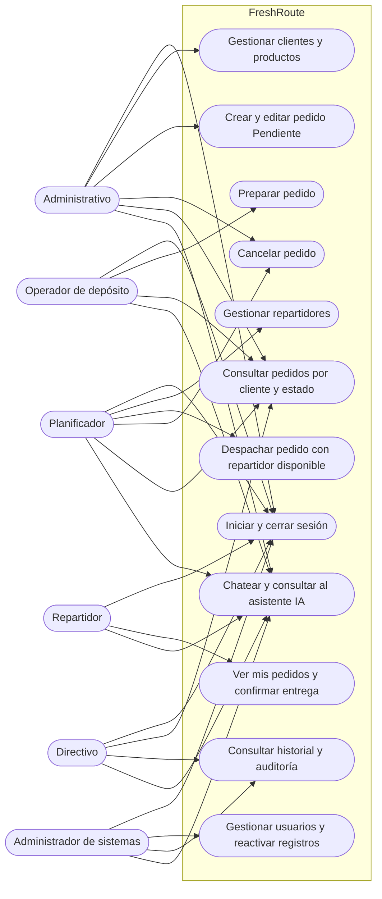
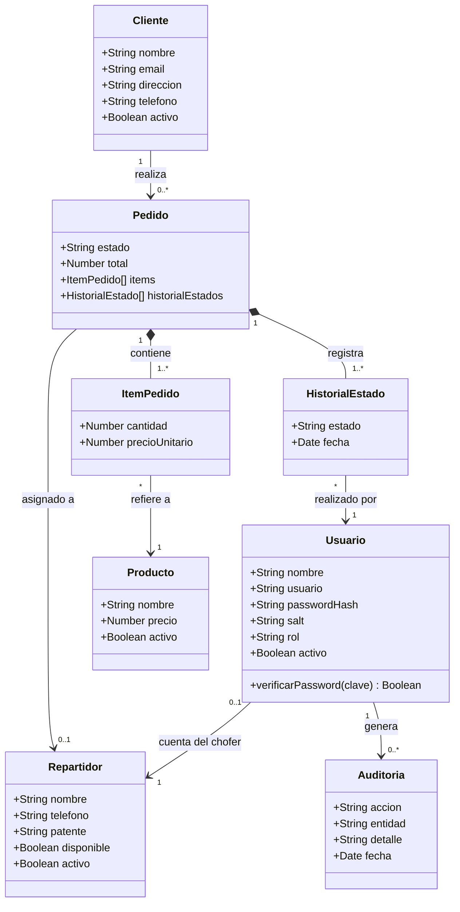
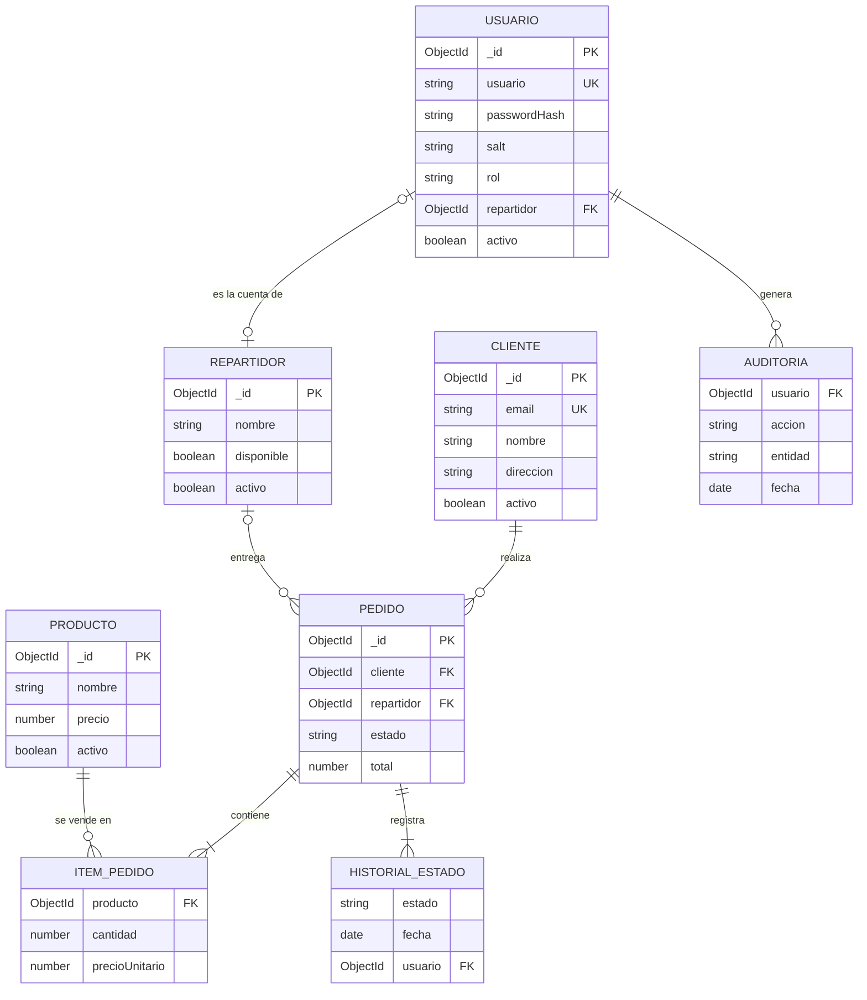
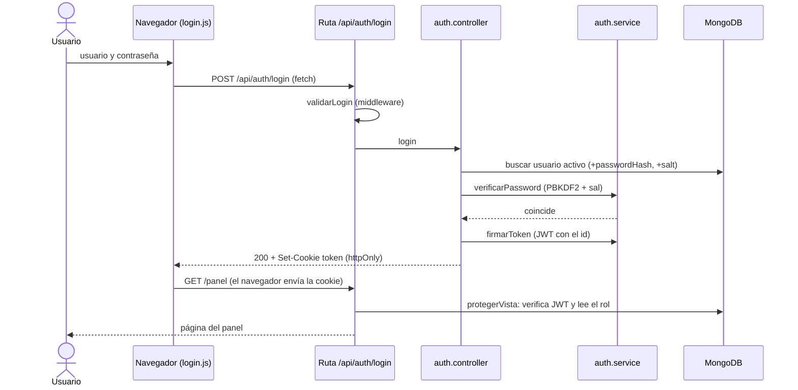
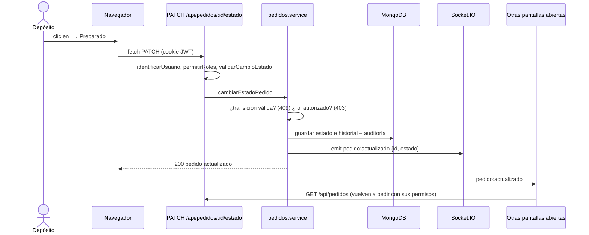
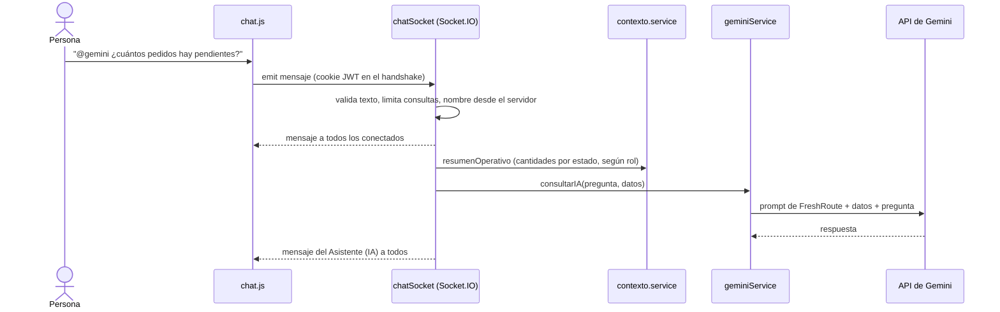

# Diagramas (Ingeniería de Software aplicada al backend de FreshRoute)

Los diagramas están en **Mermaid**: GitHub los dibuja directamente en este archivo.

## 1. Casos de uso

## 2. Diagrama de clases (modelo de dominio)

## 3. Modelo de datos (entidad–relación, MongoDB)

`ITEM_PEDIDO` y `HISTORIAL_ESTADO` están **embebidos** dentro del documento `pedidos` (se leen siempre junto con el pedido); el resto son colecciones con referencias.

## 4. Secuencia: inicio de sesión con JWT en cookie

## 5. Secuencia: cambio de estado de un pedido con aviso en tiempo real

## 6. Secuencia: chat con el asistente IA

